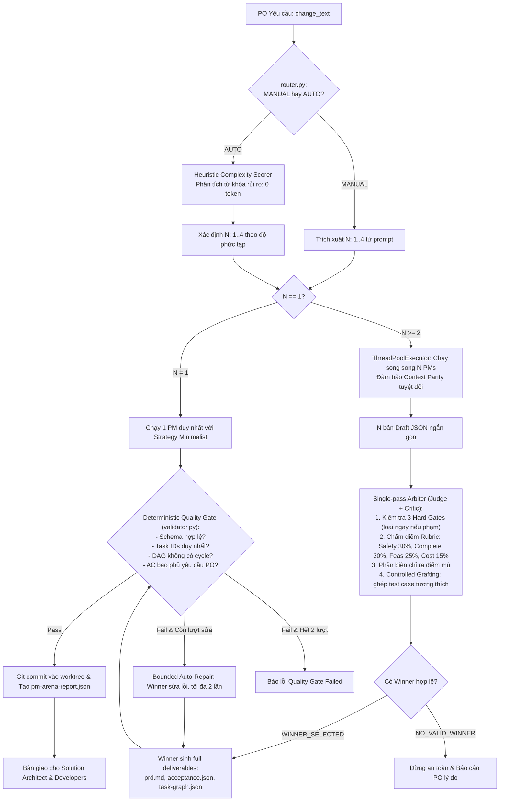

# Hướng dẫn Kỹ thuật: Codex PM Arena Skill

Tài liệu này mô tả chi tiết toàn bộ kiến trúc, thuật toán, logic nghiệp vụ và cách bảo trì/mở rộng module **Codex PM Arena** trong dự án **AI Software Company**.

---

## 1. Giới thiệu & Mục tiêu (Overview)

Module **Codex PM Arena** được lấy cảm hứng từ mô hình *Arena Skill* (vốn thiết kế cho Claude Code) và được tái cấu trúc tối ưu cho **Codex CLI / Codex Gateway**.

### Vấn đề giải quyết:
Trong các hệ thống AI tự hành, nếu chỉ có 1 AI Project Manager (PM) lập kế hoạch:
* Dễ rơi vào thiên kiến (bias), bỏ sót các trường hợp ngoại lệ (edge-cases).
* Dễ đề xuất phương án over-engineering hoặc gây vỡ mã nguồn cũ (regression).
* Hậu quả: Backend/Frontend code sai $\to$ QA Tester báo lỗi $\to$ Kích hoạt vòng **Repair Loop** lãng phí 40.000 – 80.000 tokens của các kỹ sư.

### Giải pháp PM Arena:
* Khởi tạo **$N$ PM ứng viên** ($N \in [1, 4]$) với các trường phái chiến lược đối lập.
* Cho các ứng viên độc lập sinh bản tóm tắt kế hoạch (Drafting).
* Một **Trọng tài độc lập (Single-pass Arbiter: Judge + Critic)** kiểm tra các điều kiện an toàn loại trực tiếp (**Hard Gates**), chấm điểm theo **Scoring Rubric (30/30/25/15)**, phản biện điểm yếu và chọn ra **1 PM Quán quân**.
* **Kế thừa có kiểm soát (Controlled Grafting)**: Trích xuất 1–2 ca kiểm thử hay nhất từ các PM thua cuộc ghép vào phương án thắng cuộc (nếu tương thích 100%).
* **Cổng kiểm tra chất lượng thuần code (Deterministic Quality Gate)**: Kiểm tra cấu trúc đồ thị DAG (không có cycle), tính duy nhất của task ID và độ bao phủ yêu cầu bằng Python (0 token) trước khi chuyển giao.

---

## 2. Cấu trúc Mã nguồn (Directory Layout)

Toàn bộ logic của PM Arena được đóng gói độc lập trong thư mục `apps/roles/pm_arena/`:

```text
apps/roles/pm_arena/
├── __init__.py         # Export các interface chính (PMArenaRunner, ArenaTelemetry, v.v.)
├── strategies.py       # Định nghĩa 4 Personas & Strategy Cards
├── router.py           # Bộ định tuyến số lượng PM (MANUAL regex & AUTO Heuristic 0-token)
├── prompts.py          # Hệ thống Prompt templates (Context, Draft, Arbiter, Winner Finalizer)
├── validator.py        # Deterministic Quality Gate (0 token, kiểm tra DAG, Schema, Cycle)
└── runner.py           # Bộ điều phối chính (Orchestrator, threading, grafting, report generation)
```

Tích hợp vào Worker tại: [`apps/worker/main.py`](file:///c:/Users/nguye/Desktop/paperclip/apps/worker/main.py) (dòng 135–145).  
Bộ kiểm thử tự động tại: [`tests/test_pm_arena.py`](file:///c:/Users/nguye/Desktop/paperclip/tests/test_pm_arena.py).

---

## 3. Quy trình Thực thi Chi tiết (Execution Pipeline)



---

## 4. Chi tiết các Thành phần Kỹ thuật

### 4.1 Bộ định tuyến Số lượng PM (`router.py`)
Hỗ trợ 2 chế độ:
1. **Chế độ MANUAL (Người dùng chỉ định)**:
   * Nhận diện các mẫu câu trong prompt: `chạy 2 pm`, `dùng 3 pm`, `use 4 pms`, `1 pm`, v.v.
   * Nếu phát hiện, gán chính xác số lượng PM được yêu cầu (giới hạn trong khoảng $[1, 4]$).
2. **Chế độ AUTO (Heuristic 0-Token)**:
   * Nếu PO không nhắc đến số PM, bộ phân tích tĩnh quét từ khóa:
     * **Từ khóa rủi ro cao (+2 điểm/từ)**: `payment`, `checkout`, `auth`, `security`, `migration`, `schema`, `database`, `breaking`, `delete`, `concurrency`, `shipping`, `discount`, `pricing`, `vip`, `order`, `refund`, `refactor`.
     * **Từ khóa trung bình (+1 điểm/từ)**: `api`, `endpoint`, `model`, `validation`, `field`, `table`, `state`, `feature`, `calculate`.
     * **Từ khóa thẩm mỹ/nhỏ (-1 điểm/từ)**: `text`, `typo`, `css`, `color`, `style`, `label`, `button`, `doc`, `readme`.
   * **Bảng ánh xạ số lượng PM**:
     * Điểm $\le 0$: **1 PM** (Thay đổi thẩm mỹ, text nhỏ $\to$ tiết kiệm token tuyệt đối).
     * Điểm $1 - 2$: **2 PMs** (Tính năng vừa phải, endpoint độc lập).
     * Điểm $3 - 5$: **3 PMs** (Tính toán nghiệp vụ, giá VIP, khuyến mãi).
     * Điểm $\ge 6$: **4 PMs** (Đại tu database, core checkout, rủi ro cao).

---

### 4.2 Bốn Chiến lược PM (`strategies.py`) & Context Parity
* **Context Parity (Bình đẳng ngữ cảnh)**: 100% các PM đều nhận chung một bản tóm tắt hệ thống (System contracts, coding rules, PO request, tech stack). Khác biệt duy nhất là **Strategy Card**:
  1. `minimalist` (Minimalist & Regression-Safe): Phạm vi sửa đổi tối thiểu, bảo toàn code cũ, không refactor ngoài phạm vi, rủi ro hồi quy = 0.
  2. `edge_case` (Edge-Case Sentinel): Tập trung vào validation biên, xử lý mã lỗi HTTP/DB, concurrency, idempotency và test phòng thủ.
  3. `architectural` (Scalable & Clean Architecture): Tách biệt tầng trách nhiệm, schema chuẩn hóa, không hardcode magic values, hướng đến mở rộng lâu dài.
  4. `user_centric` (User-Centric & PO-Aligned): Tối ưu trải nghiệm người dùng, giao diện trực quan, thông báo lỗi rõ ràng, dễ nghiệm thu.

---

### 4.3 Trọng tài Độc lập (`Single-pass Arbiter`)
Arbiter kết hợp cả 4 nhiệm vụ trong **1 lần gọi model duy nhất**:
1. **Hard Gates (Loại trực tiếp)**:
   * *Gate 1*: Có làm vỡ schema/API mà thiếu phương án migration hoặc backward compatibility?
   * *Gate 2*: Có nguy cơ làm mất dữ liệu hoặc gây lỗi hồi quy nghiêm trọng không kiểm soát?
   * *Gate 3*: Có vi phạm hoặc bỏ sót yêu cầu bắt buộc của PO?
   * $\to$ *Nếu vi phạm bất kỳ Hard Gate nào, ứng viên bị loại lập tức (disqualified).*
2. **Scoring Rubric**:
   $$\text{Score} = (\text{Safety} \times 0.30) + (\text{Completeness} \times 0.30) + (\text{Feasibility} \times 0.25) + (\text{Cost Efficiency} \times 0.15)$$
3. **Phản biện (Critic)**: Chỉ ra điểm mù/rủi ro của từng phương án.
4. **Trạng thái `NO_VALID_WINNER`**: Nếu tất cả PM đều phạm Hard Gate hoặc điểm an toàn $< 5.0$, Arbiter trả về `NO_VALID_WINNER`. Hệ thống **dừng an toàn, không sinh code ẩu**, ghi log chi tiết lý do để PO nắm và sửa lại đề bài.
5. **Controlled Grafting**: Arbiter trích xuất 1–2 tiêu chí nghiệm thu hay nhất từ các PM bị loại để bổ sung vào phương án thắng, kèm theo xác nhận tính tương thích kiến trúc.

---

### 4.4 Cổng Kiểm tra Chất lượng (`DeterministicQualityGate`)
Module `validator.py` chạy bằng **Python thuần (0 token, 0 latency)** sau khi PM chiến thắng sinh file:
* **Kiểm tra File**: Đảm bảo đủ 3 file bắt buộc (`prd.md`, `acceptance.json`, `task-graph.json`) và không rỗng.
* **Kiểm tra PRD**: Độ dài $\ge 100$ ký tự, có cấu trúc tiêu đề rõ ràng, bao phủ ngữ nghĩa của PO request.
* **Kiểm tra Acceptance JSON**: Có danh sách tiêu chí, có ID duy nhất và mô tả rõ ràng.
* **Kiểm tra Đồ thị Task DAG**:
  * Task IDs phải duy nhất, không trùng lặp.
  * Dependency phải tham chiếu đến task tồn tại.
  * **Thuật toán DFS Topological Sort**: Bắt lỗi chu trình tuần hoàn (Circular Dependency Cycle).
* **Vòng sửa lỗi giới hạn (Bounded Auto-Repair)**: Nếu Quality Gate không đạt, hệ thống gửi danh sách lỗi cụ thể cho PM sửa lại (tối đa 2 lần).

---

## 5. Báo cáo & Bằng chứng Đấu trường (`pm-arena-report.json`)

Mỗi lần chạy Arena, hệ thống xuất một file báo cáo toàn diện tại `.ai-company/handoffs/project-manager/pm-arena-report.json`:

```json
{
  "schema_version": "1",
  "task_id": "task-pm-123",
  "telemetry": {
    "mode": "auto",
    "pm_count": 3,
    "router_reason": "auto: score=4 (high-risk business logic change)",
    "model_calls": 5,
    "duration_seconds": 12.4,
    "status": "completed",
    "winner_id": "minimalist",
    "grafted_count": 1,
    "quality_gate_passed": true,
    "repair_attempts": 0
  },
  "winner": {
    "id": "minimalist",
    "strategy": "Minimalist & Regression-Safe"
  },
  "arbiter_summary": "Minimalist plan chosen for zero regression risk on existing storefront.",
  "evaluations": [ ... ],
  "grafted_items": [ ... ],
  "quality_gate": {
    "passed": true,
    "errors": [],
    "warnings": []
  }
}
```

---

## 6. Hướng dẫn Kiểm thử & Tùy biến (Maintenance & Extension)

### 6.1 Chạy Unit Tests
Chạy kiểm thử toàn bộ module PM Arena:
```powershell
docker compose exec -w /workspace worker pytest tests/test_pm_arena.py -v
```

Chạy toàn bộ test suite của cả hệ thống để kiểm tra hồi quy:
```powershell
docker compose exec -w /workspace worker pytest
```

### 6.2 Cách bổ sung một Persona mới
1. Mở file [`apps/roles/pm_arena/strategies.py`](file:///c:/Users/nguye/Desktop/paperclip/apps/roles/pm_arena/strategies.py).
2. Thêm một đối tượng `PMStrategy` vào từ điển `STRATEGIES`:
   ```python
   "security_first": PMStrategy(
       id="security_first",
       name="Security & Compliance First",
       persona="Cybersecurity Auditor & AppSec Lead",
       core_focus="Rà soát OWASP Top 10, phân quyền RBAC và mã hóa dữ liệu.",
       decision_bias="Mọi endpoint đều phải kiểm tra quyền và chống injection.",
       risk_appetite="Cực kỳ thấp với lỗ hổng bảo mật.",
   )
   ```
3. Cập nhật danh sách ưu tiên `ORDERED_STRATEGY_KEYS`.

### 6.3 Cách tùy chỉnh Trọng số Chấm điểm (Rubric)
Mở file [`apps/roles/pm_arena/prompts.py`](file:///c:/Users/nguye/Desktop/paperclip/apps/roles/pm_arena/prompts.py), tìm hàm `build_arbiter_prompt` để điều chỉnh tỷ lệ phần trăm (hiện tại là 30% Safety, 30% Completeness, 25% Feasibility, 15% Cost-efficiency).

### 6.4 Cách tắt hoặc bật Arena
Trong môi trường hoặc file `.env`:
* `ENABLE_PM_ARENA=true` (mặc định): Bật chế độ Đấu trường PM.
* `ENABLE_PM_ARENA=false`: Tắt Arena, quay về chế độ 1 PM truyền thống.

